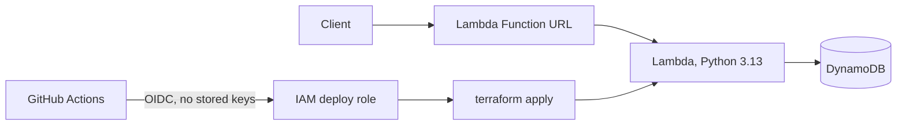

# URL Shortener on AWS

A serverless URL shortener deployed entirely with Terraform and GitHub Actions. A Lambda Function URL fronts one Python Lambda that stores links in DynamoDB.

## Try it

    curl -X POST <function-url> -H "Content-Type: application/json" -d '{"url":"https://example.com/long/path"}'
    # {"short_url": "<function-url>/Ab3dE9x"}

Opening the short URL redirects (HTTP 302) to the original.

## Architecture

## How deployment works

- Pull requests run unit tests, `terraform fmt -check` and `terraform validate`.
- Merging to `main` runs `terraform apply` against AWS.
- GitHub authenticates to AWS through OIDC. No AWS keys are stored in GitHub.
- The deploy role only trusts workflow runs from this repository on the `main` branch.
- Terraform state lives in a versioned S3 bucket with native state locking.

## Known limitations

- The deploy role uses AdministratorAccess to keep things simple. A least-privilege policy is the next step.
- The function URL is public with no authentication or rate limiting.
- There is a single environment (no separate prod).

## Lessons learned

- GitHub's OIDC token subject claim can include numeric owner and repository IDs. The trust policy has to match the exact claim, which I found by printing the token's claims in a temporary debug step.
- A GitHub OIDC provider already existed in the account, so it had to be imported into Terraform instead of created.
- The CI lock file must include the Linux platform, because I develop on Windows and CI runs on Linux.

## What I would do next

- Put API Gateway or CloudFront in front, with a custom domain and throttling.
- Replace AdministratorAccess with a least-privilege deploy role.
- Add a prod environment with a manual approval gate.
- Add CloudWatch alarms and a security scanner in CI.
